# NextGen Envanter

Restoranlar için **envanter yönetimi** uygulaması (macOS; Windows sürümü [`windows/`](windows/README.md)): stok kalemleri, reçeteler, satış raporu aktarımı, günlük sayım ve fark, sipariş ve ekip. Excel'deki envanter dosyasının (Envanter, KOD, Alımlar, Özet sayfaları ve makroları) yaptığı işi otomatik yapar: ModPos satış raporunu reçetelerle hammaddeye çevirir, günlük sayımla karşılaştırır ve farkı **miktar olarak** (adet / kg) gösterir. Şirket içi kullanım içindir (App Store'da yayınlanmaz).

Uygulama şubedeki bilgisayara kurulur; patron ve müdürler aynı veriyi **web panelinden** ([envantersite](https://github.com/RiosenBeq/envantersite)) her yerden, **anlık** izler. Para hesabı (birim maliyet, food cost, personel maliyeti, prime cost, hedefler) yoktur.

> Ekran görüntülerindeki rakamlar `EnvanterTool demo` ile üretilmiş **örnek verilerdir** ("Burger Yiyelim · Tuzla Marina" demo şubesi).

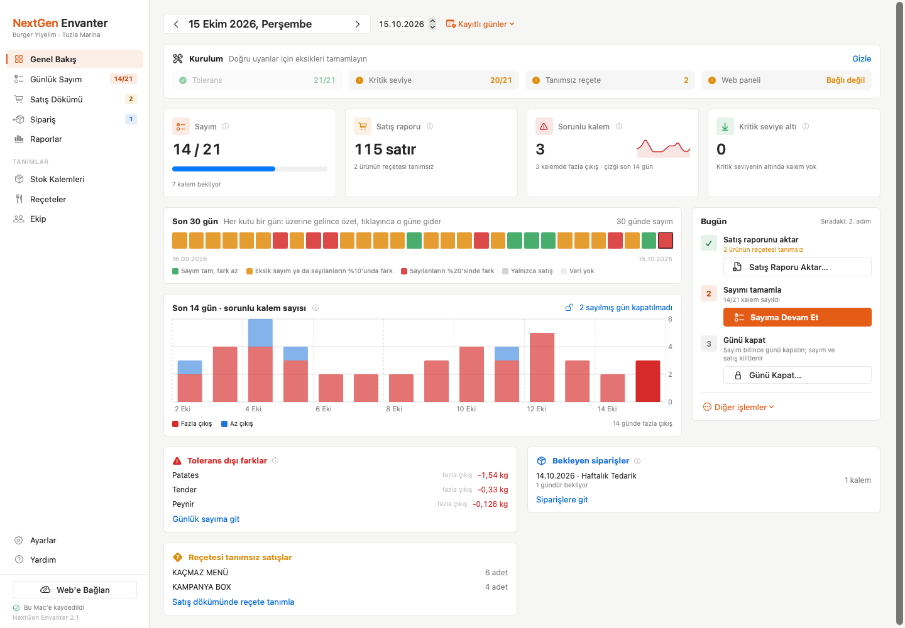

## Özellikler

| Ekran | Ne işe yarar |
| --- | --- |
| **Genel Bakış** | İlk açılışta (henüz günlük kayıt yokken) **başlangıç kartı** üç yolla: **bağlantı koduyla web paneline bağlanma**, yedekten (ya da eski Excel dosyasından) geri yükleme, sıfırdan başlama (stok kalemleri, reçeteler, ilk satış raporu). **Bugün** kartı günün üç adımını sırayla gösterir (① satış raporunu aktar ② sayımı tamamla, ör. `14/21` ③ günü kapat), her adımın durumu ve tek düğmesiyle; diğer işlemler (panodan satış, sipariş önerisi, dönem raporu, ekip, sayım formu, günü Excel'e aktarma) tek bir **Diğer işlemler** menüsünde. Seçili günün sayım ilerlemesi, satış raporu durumu, tolerans dışı ve **fazla çıkış** olan kalemler, kritik seviyenin altındakiler (sayım girilmemiş günde **tahmini stoğa** göre: son sayım + sonraki hareketler) ve açık siparişler. Patron / müdür için tamamlanana kadar **kurulum listesi** (tolerans x/N · kritik seviye x/N · tanımsız reçete · web paneli bağlantısı). Son 30 günün **takip şeridi** (yeşil: sayım tam, fark az · sarı: eksik sayım ya da sayılanların %10'unda fark · kırmızı: sayılanların %20'sinde fark) ve son 14 günün sorunlu kalem grafiği; **kapatılmamış günler** listesi (son 60 günde sayılmış ama kapatılmamış günler, her biri kontrol listesiyle; patron / müdür seçtiklerini topluca kapatır, uyarısız günler önceden seçili). *Dikkat* listeleri: tolerans dışı farklar, kritik seviyenin altındaki stoklar (sayılmayanlar "tahmini" etiketiyle), açık siparişler ve reçetesi tanımsız satışlar. |
| **Günlük Sayım** | Açılış (son sayımdan otomatik; arada sayılmayan günler varsa onların gelen, transfer, satış ve zayisi eklenir, `≈ 25` diye tahmini yazılır), Gelen, Transfer, Kapanış girişi. Bir kalemin ilk sayımı (ya da 31 günden eski son sayımdan sonraki sayım) başlangıç kabul edilir: fark hesaplanmaz (*İlk sayım*). Beklenenden farklı girilen elle açılış *Sorunlu* sayılır. Satılan/Zayi reçeteden otomatik gelir; bozulan, yanan, düşen ya da iade edilen mal **Zayi Ekle** ile elle girilir (kalem, miktar, neden, not, kim; o günün ModPos zayisi gösterilir, ⌘Z ile geri alınır) ve Zayi'ye eklenir; Zayi hücresi ModPos ve elle girilen zayinin dökümünü açar. Fiili Tüketim ve Fark hesaplanır. Tolerans ve kritik seviyeye göre renkler, *Sayılmayan / Sorunlu* filtresi ve **kalem arama** (⌘F; Enter ilk kalemin kapanışına gider). Sayı hücrelerine **toplayarak giriş**: `12+8+5`, `3x24+7` ya da `3*24+7` yazılabilir, kaydedince ipucu "12+8+5 = 25" der. Gün notu, sayımı yapan kişi (*Sayan*: ekipten seçilir), **günü kapatma kilidi** (sayım girilmemiş gün kapatılamaz; kapatmadan önce **kontrol listesi**: sayım tamam mı, satış raporu aktarıldı mı, tanımsız reçete var mı, bilgi olarak tolerans dışı fark; eksik varsa "Yine de Kapat" ve "Sayılmayanları Göster"), hareketsiz kalemleri tek tıkla doldurma (satış raporu aktarıldıktan sonra; tahmini açılışlara yazmaz) ve satır bazında hesap dökümü (devreden günler dahil). |
| **Satış Dökümü** | ModPos satırlarını *reçeteli / stok etkisi yok / reçete tanımsız* olarak ayırır. Her satırın stoktan düşürdüğü miktarlar görünür; reçete tek tıkla tanımlanır. |
| **Sipariş** | Öneri = son 7/14/30 günün ortalama tüketimi × istenen gün + kritik seviye − mevcut stok − **siparişte bekleyen**. Mevcut stok, son sayıma sonraki günlerin gelen/transfer ve satışları eklenerek tahmin edilir (son sayım 31 günden eskiyse bilinmiyor sayılır). Öneriden **satın alma siparişi** oluşturulur; teslim alınınca miktarlar o günün *Gelen* sütununa işlenir. Liste WhatsApp için kopyalanabilir veya Excel'e aktarılabilir. |
| **Raporlar** | *Dönem Özeti:* dönem toplamları (ilk açılış, gelen, net transfer, satılan, zayi, fiili tüketim, fark, **fazla çıkış**) ve kalem bazında günlük fark grafiği (tolerans bandıyla). *Kalem Analizi:* beklenen ve fiili tüketim, günlük fark ve stok seviyesi. |
| **Stok Kalemleri** | Birim, reçete birimi ve katsayı, **kritik seviye**, **tolerans (± adet/kg)**, bugünkü **tahmini stok**; arama, sıralama ve gizleme. **Eşik önerileri (N):** son 28 günün sayım farklarına (%80'lik dilim) ve tüketimine (× 1,5) göre tolerans ve kritik seviye önerir; boş alanlar seçili gelir, *Önerilenleri uygula* ile tek adımda (⌘Z ile geri alınır) yazılır. |
| **Reçeteler** | Hazır reçeteler; hammadde ekleme/çıkarma, başka üründen kopyalama. |
| **Ekip** | **Eleman ekleme**, düzenleme, pasif yapma ve silme (ad, görev, telefon, işe giriş/çıkış, not). Sayımı yapan kişi ekipten seçilir. Patron web paneline bağlıyken **Kullanıcılar** bölümünden **hesap oluşturur** (e-posta ya da yalnızca kullanıcı adıyla, geçici şifreyle), yetki değiştirir, şifre belirler ve şubeden çıkarır; hesap bir ekip üyesine bağlanabilir. |
| **Ayarlar** | Şube adı, sipariş varsayılanları, **web paneli ile eşitleme** (bkz. aşağıda), otomatik kayıt ve yedekler, yedek dosyası, Excel'e aktarım, **sayım formu** ve eski Excel dosyasından içe aktarım. |
| **Yardım** | Başlarken, adım adım günlük iş akışı, notlar ve ipuçları, kısayollar ve aranabilir **terimler sözlüğü**. |

Yan menü sade tutulur: üstte günlük işler (Genel Bakış, Günlük Sayım, Satış Dökümü, Sipariş, Raporlar), **Tanımlar** başlığı altında Stok Kalemleri, Reçeteler ve Ekip; altta ayrı olarak Ayarlar ve Yardım. Web paneline bağlı değilken menünün altında **Web'e Bağlan** düğmesi, bağlıyken eşitleme durumu görünür (oturumun süresi dolduysa ikisi birlikte). Sıra web paneliyle aynıdır.

Diğer:
- **Terim açıklamaları:** tolerans, fazla çıkış, fiili tüketim gibi terimlerin yanındaki ⓘ işaretinin üzerine gelince kısa açıklama çıkar, tıklayınca ayrıntılı açıklama açılır.
- **Liquid Glass tasarım:** macOS 26'da Apple'ın yerel Liquid Glass yüzeyleri; macOS 14–15'te aynı yüzeyler buzlu cam malzemesiyle çizilir.
- **Geri al / Yinele** (⌘Z / ⇧⌘Z) tüm veri değişikliklerinde çalışır.
- **Kayıt ve yedek:** Otomatik kayıt yapılır, kayıt durumu yan menüde görünür. Günlük yedekler son 30 günü kapsar ve riskli işlemlerden önce anlık kopya alınır. Dosya bozulursa en son yedekten otomatik dönülür; o da okunamazsa bozuk dosya kenara alınır, üzerine yazılmaz.
- **Satış raporu:** `.xlsx`, `.csv` ve `.txt` (UTF-8, UTF-16, Windows-1254) dosyaları ya da pano kabul edilir; dosya hangi ekranda olursa olsun pencereye sürüklenip bırakılabilir. Raporda *Tutar* sütunu varsa yok sayılır.
- **Excel'e aktarım:** Eski *Alımlar* sayfasıyla aynı sütun düzeni kullanılır (pivot tablolar çalışmaya devam eder). Ek olarak Özet ve Günlük Durum sayfaları, varsa Notlar, Zayi Kayıtları ve Ekip sayfaları yazılır.

### Kısayollar

| Kısayol | İşlem |
| --- | --- |
| ⌘O / ⌘⇧V | Satış raporu aktar / panodan yapıştır |
| ⌘E | Günü Excel'e aktar |
| ⌘[ / ⌘] / ⌘T | Önceki gün / sonraki gün / bugün |
| ⌘L | Günü kapat / kilidi aç |
| ⌘F | Kalem ara (Günlük Sayım; Stok Kalemleri açıksa oradaki arama) |
| ⌘1 … ⌘8 | Genel Bakış, Günlük Sayım, Satış Dökümü, Sipariş, Raporlar, Stok Kalemleri, Reçeteler, Ekip |
| ⌘, | Ayarlar |
| ⌘Z / ⇧⌘Z | Geri al / yinele |

## Ekran görüntüleri

Görüntüler CI'da, uygulama `EnvanterTool demo` ile üretilen örnek veriyle çalıştırılarak otomatik alınır; *İlk açılış* görüntüsü boş bir veri klasörüyle alınır; *Web Paneline Bağlan* görüntüsü bağlanma penceresini örnek bir kodla gösterir.

| | |
| --- | --- |
| 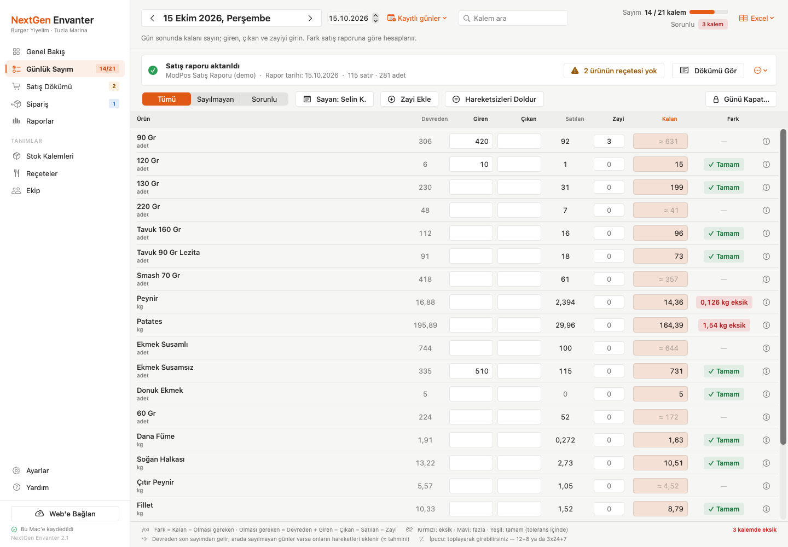 **Günlük Sayım** | 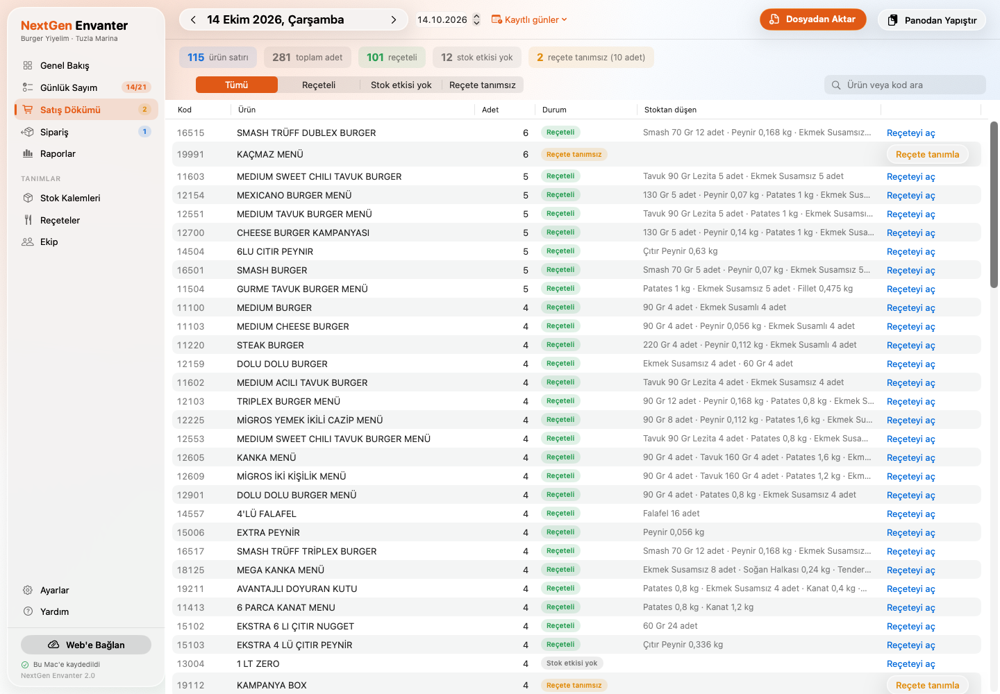 **Satış Dökümü** |
| 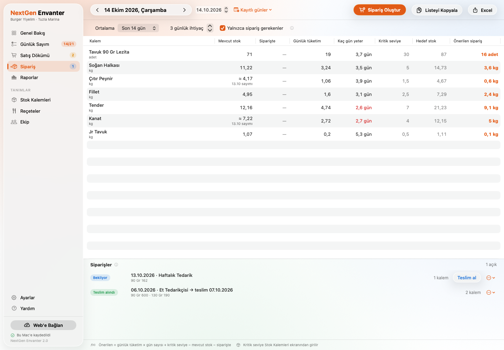 **Sipariş** | 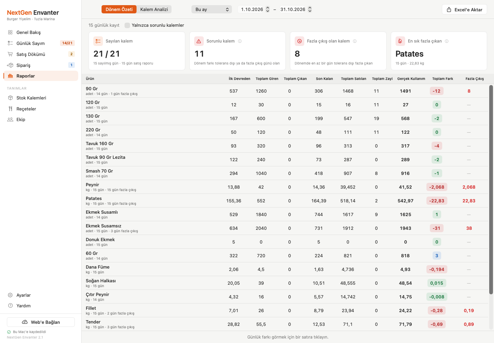 **Raporlar · Dönem Özeti** |
| 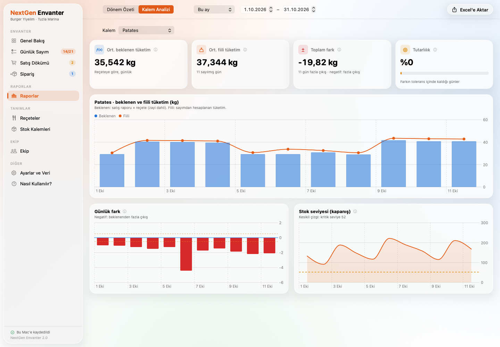 **Raporlar · Kalem Analizi** | 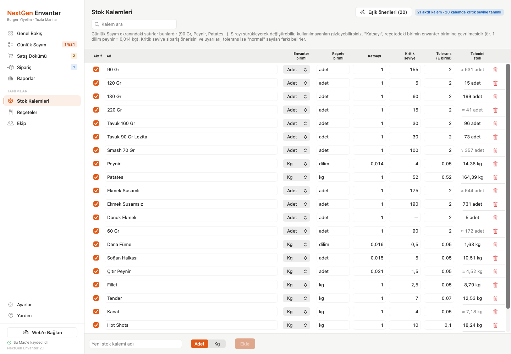 **Stok Kalemleri** |
| 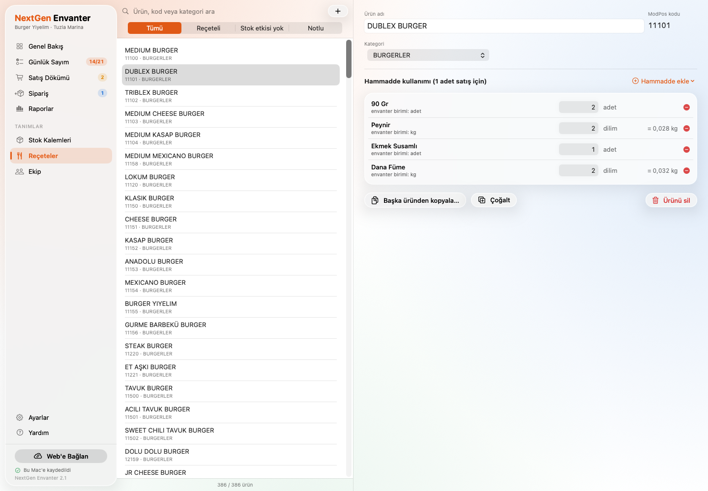 **Reçeteler** | 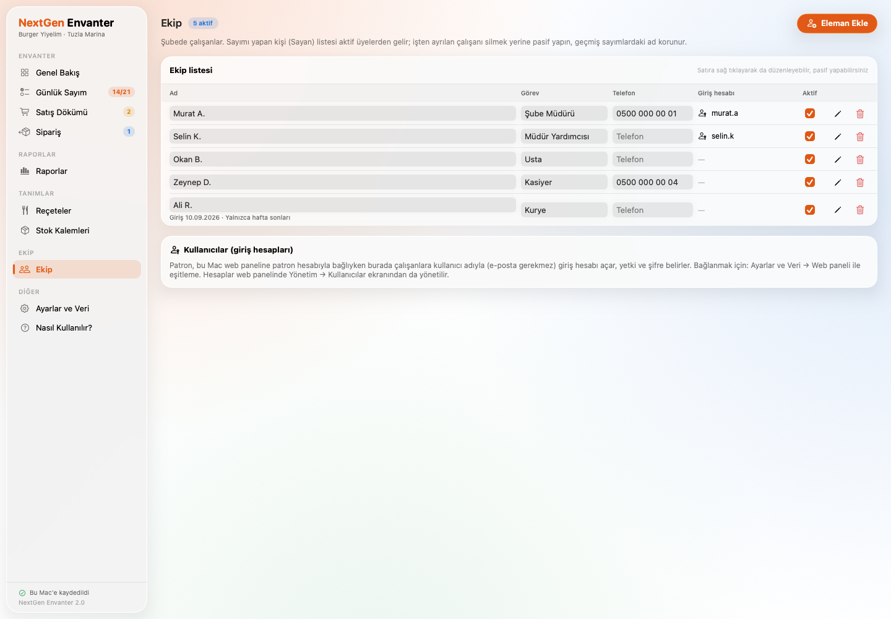 **Ekip** |
| 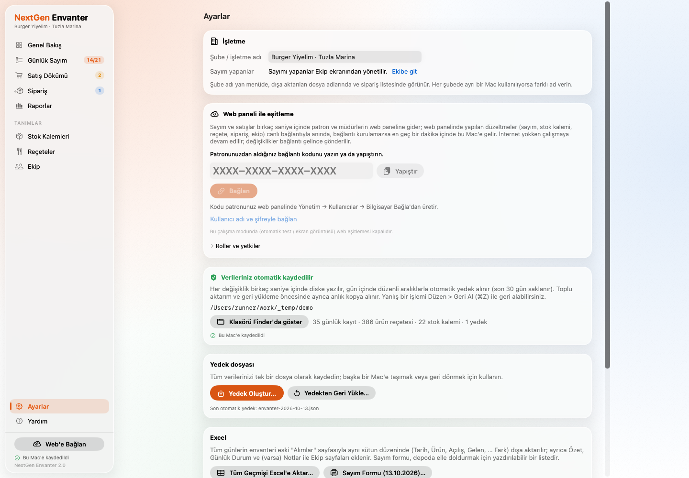 **Ayarlar** | 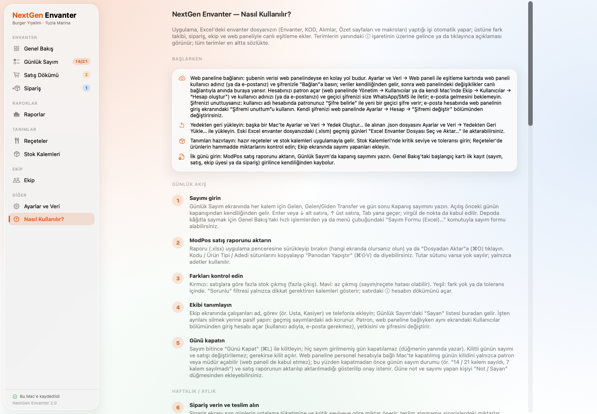 **Yardım** |
| 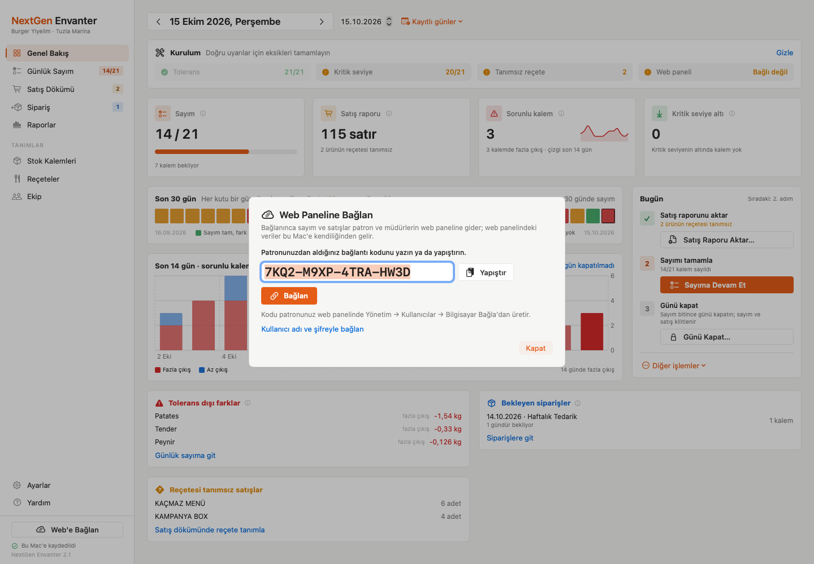 **Web Paneline Bağlan (bağlantı kodu)** | 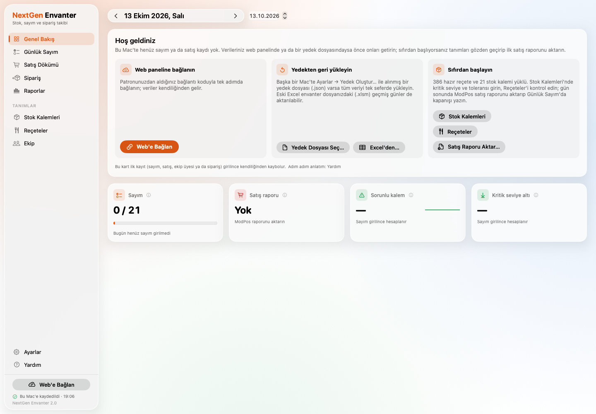 **İlk açılış (boş veri): başlangıç kartı** |

## Kurulum (şirket içi)

1. Bir Mac'te (macOS 14+, Xcode 15+ veya Swift 5.9+ araç zinciri) derleyin:
   ```bash
   ./Scripts/build_app.sh          # build/NextGen Envanter.app + build/NextGen-Envanter-2.0.zip
   ./Scripts/build_app.sh --dmg    # ayrıca .dmg
   ```
   Hazır paket, GitHub Actions'taki her başarılı çalışmanın **NextGen-Envanter** artifact'ında da bulunur.
2. `.zip`'i diğer Mac'lere kopyalayın, `NextGen Envanter.app`'i *Uygulamalar* klasörüne taşıyın.
3. Uygulama ad-hoc imzalıdır. İlk açılışta macOS uyarı verirse Finder'da uygulamaya sağ tıklayıp **Aç** deyin ya da:
   ```bash
   xattr -dr com.apple.quarantine "/Applications/NextGen Envanter.app"
   ```

Veriler `~/Library/Application Support/Envanter/` altında tutulur (`envanter-verisi.json` ve `Yedekler/`). Uygulamayı silmek veya güncellemek verilere dokunmaz. Başka bir klasör kullanmak için `ENVANTER_DATA_DIR` ortam değişkeni verilebilir.

**Eski sürümden geçiş:** Eski sürümlerin veri dosyası olduğu gibi açılır. Maliyet, fiyat geçmişi, ücret ve vardiya alanları artık kullanılmaz: bu Mac'teki dosyadan ilk kayıtta düşer (önceki hali `Yedekler/` altındaki günlük yedeklerde kalır), bulutta ise silinmez. Eski "sayım yapanlar" listesi kendiliğinden **Ekip**'e taşınır. Yeni sürümün aldığı yedek eski sürümde açılmayabilir.

### Windows

Mağaza bilgisayarı Windows ise [`windows/`](windows/README.md) klasöründeki **NextGen Envanter (Windows)** kurulur: web panelini kendi penceresinde açan, `envanter://` bağlantılarını tanıyan ve bağlantı koduyla tek adımda bağlanan masaüstü uygulaması (Electron). Kurulum dosyası (`NextGen-Envanter-Kurulum-<sürüm>.exe`) GitHub Actions'taki **Windows** iş akışının **NextGen-Envanter-Windows** artifact'ındadır. İmzasız olduğu için Windows "bilgisayarınız korundu" uyarısı verirse **Ek bilgi → Yine de çalıştır** deyin. Ayrıntılar: [windows/README.md](windows/README.md).

## Web paneli ve anlık eşitleme

Mac uygulaması, patron ve müdürlerin kullandığı **web paneliyle** ([envantersite](https://github.com/RiosenBeq/envantersite)) Supabase üzerinden **anlık** eşitlenir.

- **Kim ne kullanır:** Personel günlük işleri (sayım, satış raporu aktarımı, gün notu) bu uygulamada yapar. Patron ve müdürler web panelinden her yerden izler (pano, raporlar, uyarılar, şube karşılaştırması, kimin neyi değiştirdiği, **Mac'in şu an açık olup olmadığı**) ve gerektiğinde müdahale eder (sayım düzeltme, sipariş onayı ve teslim alma, stok kalemleri ve reçeteler, ekip, kullanıcılar ve yetkiler).
- **Anlık:** Mac'te yapılan değişiklik 2 sn içinde gönderilir; web panelinde yapılan değişiklik Mac'e Supabase Realtime ile hemen gelir (bağlantı kurulamazsa 60 sn'de bir eşitlenir). Web panelinde "Mac çevrimiçi" göstergesi Mac açıkken yanar.
- **Bağlanma (bağlantı kodu):** Patron web panelinde *Yönetim → Kullanıcılar → **Bilgisayar Bağla*** ile bir kod üretir (ör. `7KQ2-M9XP-4TRA-HW3D`) ve WhatsApp ile gönderir ya da kopyalar. Mac'te yan menüdeki (ya da başlangıç kartındaki, uygulama menüsündeki) **Web'e Bağlan** → kodu yazın ya da mesajı **Yapıştır** ile yapıştırın → **Bağlan**; *Ayarlar > Web paneli ile eşitleme* kartında kod alanı doğrudan görünür. Kullanıcı adı, şifre, şube ya da sunucu ayarı sorulmaz: kod, bu bilgisayara ayrılmış bir cihaz hesabının (`pc-xxxxxx`) giriş bilgisidir ve rolünü (müdür ya da personel) patron kodu üretirken seçer.
  - Web panelindeki **Bu bilgisayardaki uygulamada aç** bağlantısı (`envanter://baglan?kod=…&sunucu=…&anahtar=…`) uygulamayı öne getirir ve bağlanma penceresini kod (ve sunucu ayarı) dolu açar; bu Mac henüz bir şubeyle eşleşmemişse ve bağlantının sunucusu varsayılan (ya da bu Mac'te kayıtlı) sunucuysa hemen bağlanır. Başka bir sunucuyu gösteren bağlantıda uyarı çıkar ve **Bağlan**'a basılması beklenir; eşleşmiş Mac'te de **Bağlan** beklenir (şube değişimi kuralları geçerlidir, başka sunucuya geçilirken eşleşmenin bırakılacağı söylenir). Bu Mac zaten aynı kodla bağlıysa eşitleme kartı açılır.
  - **Kod tek kullanımlıktır:** Mac kodla girdikten hemen sonra cihaz hesabına kendi ürettiği rastgele bir şifre verir; kod bir daha geçmez. Bu şifre gösterilmez, günlüğe yazılmaz ve oturum anahtarlarıyla aynı dosyada (`esitleme.json`, 0600) durur. Oturumun süresi dolarsa Mac bu şifreyle sessizce yeniden girer. *Çıkış Yap*'tan (ya da ilk bağlantı kararından / şube seçiminden vazgeçtikten) sonra **Yeniden Bağlan** yeni kod istemez; kullanılmış kod yeniden yazılırsa da bu Mac kayıtlı şifresiyle girer. *Çıkış Yap ve Bu Mac'i Şubeden Ayır* ya da patronun web panelinde **Bağlantıyı kaldır** demesi sonrasında yeni kod gerekir. Şifre değiştirme isteği başarısız olursa (ya da durum diske yazılamazsa) kod geçerli kalır ve Mac bağlıyken birkaç dakikada bir yeniden dener. Oturum geçici bir sunucu ya da bağlantı hatasıyla açılamazsa asıl hata gösterilir ve beklemeyle yeniden denenir. Yanlış ya da kullanılmış kodda: "Kod geçersiz ya da daha önce kullanılmış. Patronunuzdan yeni bir kod isteyin."
  - Web panelinin *Yönetim → Kullanıcılar* ekranı, Mac açıkken bu bilgisayarı *Çevrimiçi* gösterir (çevrimiçi bilgisinde yalnızca cihaz adı `pc-xxxxxx` gider). Mac'teki *Ekip → Kullanıcılar* bölümünde cihaz hesabı "Bağlantı koduyla bağlanan bilgisayar" olarak görünür; ekip üyesine bağlanmaz, şifresi belirlenmez.
- **Bağlanma (kullanıcı adı ve şifre):** Aynı pencerede **Kullanıcı adı ve şifreyle bağlan** ile web paneli hesabının **e-postası ya da kullanıcı adı** ve şifresiyle de bağlanılır. Hesabı patron *Ekip > Kullanıcılar* bölümünde (Mac) ya da web panelinde *Yönetim → Kullanıcılar* ekranında **Hesap oluştur** ile açar: e-posta gerekmez, kullanıcı adı yeter (ör. "Ayşe Yılmaz" → giriş adı `ayse.yilmaz`). Şifre unutulursa aynı yerde **Şifre belirle** ile yeni geçici şifre verilir. Sunucu adresi ve publishable key uygulamada hazırdır (publishable key herkese açık bir anahtardır; yetkiyi veritabanındaki RLS kuralları uygular). Farklı bir Supabase projesi için bu formdaki *Gelişmiş* bölümünden değiştirilebilir.
  - Hesap birden çok şubeye üyeyse şube seçilir. Hiç şube yoksa (ilk kurulum) işletme adıyla yeni bir şube açılır ve hesap patron olur. Şubeye eklenmemiş bir hesapla bağlanılırsa patronun eklemesi gerektiği söylenir.
  - **İlk bağlantı:** Bulut boşsa bu Mac'teki her şey yüklenir. Bu Mac yalnızca varsayılan reçetelerle duruyorsa buluttaki veri indirilir. İki tarafta da veri varsa sorulur: *Buluttakini İndir* (bu Mac'teki veri önce `Yedekler/bulut-indirme-oncesi-….json` olarak saklanır) ya da *Bu Mac'tekini Yükle* (buluttaki önceki hal `Yedekler/bulut-yukleme-oncesi-….json` olarak saklanır).
  - **Şube değiştirme:** *Şube Değiştir…* ile başka şube seçilir. Şube boşsa sorulur: *Yalnızca Tanımları Kopyala* ya da *Her Şeyi Kopyala*.
- **Roller:** *Patron* her şeyi yönetir (kullanıcılar, yetkiler, şube adı dahil), *Müdür* tüm verileri değiştirir, *Personel* yalnızca günlük kayıtları (sayım, satış, not) değiştirir ve günü kapatabilir. Personel hesabıyla bağlı Mac'te stok kalemleri, reçeteler, ekip, siparişler ve ayarlar salt okunurdur; personel 7 günden eski bir güne yazınca uygulama açık kaldıkça bir kez uyarılır (yanlış güne giriş olmasın). Rol web panelinde değiştirilirse Mac çıkış yapmadan güncellenir.
- **Kapatılmış gün:** Kapatılmış (kilitli) günü yalnızca patron ve müdür değiştirebilir, kilidini açabilir ya da silebilir; sunucu da personelin bu yazmalarını reddeder.
- **Çakışmalar:** Veri belgelere bölünür (stok kalemleri, reçeteler, ayarlar, ekip, siparişler ve her gün ayrı bir belge). Aynı belge iki yerde değiştirilirse alan bazında birleştirilir: aynı güne farklı kalemlerin sayımı girilirse ikisi de korunur; aynı alan iki yerde değiştirilirse son gönderilen geçerli olur. Mac'in bilmediği alanlar (eski sürümlerin maliyet ve vardiya alanları dahil) kaybolmaz.
- **Değişiklik geçmişi:** Her gönderim web panelindeki geçmişe kısa bir özetle yazılır, ör. "09.10.2026 sayımı: 90 Gr kapanış 120 → 110", "09.10.2026 satış raporu aktarıldı (121 satır)", "Ekip: Ayşe eklendi".
- **Paylaşılan bilgisayarda kim çalışıyor:** Bağlantı koduyla bağlanan Mac (cihaz hesabı) açılınca bir kez "Şu an kim çalışıyor?" diye sorar (aktif ekip üyeleri; *Atla* ile geçilebilir, yan menüdeki addan değiştirilir; değiştirirken *Vazgeç* seçili adı korur). Seçilen ad yalnızca bu Mac'te, uygulama açık kaldıkça ve o cihaz hesabıyla bağlıyken kullanılır (çıkış yapılıp kişisel hesapla girilince kullanılmaz): değişiklik geçmişi özetine eklenir ("… → 110 · Murat A."), günün *Sayan*'ı boşsa ilk kapanışta yazılır ve *Zayi Ekle*'de "Kim" varsayılanı olur.
- **Geri al:** ⌘Z yalnızca kendi yaptığınız değişikliğin alanlarını geri alır; arada web panelinden gelen değişiklikler korunur.
- **Oturum ve gizlilik:** Kişi hesaplarının şifresi saklanmaz (bağlantı koduyla bağlanan Mac'in cihaz hesabı şifresi, Mac'in kendi ürettiği rastgele şifredir; yukarıya bakın). Oturum anahtarları ve eşitleme durumu veri klasöründeki `esitleme.json` dosyasında yalnızca kullanıcının okuyabileceği izinle (0600) tutulur; yedeklere girmez. *Çıkış Yap* eşitlemeyi durdurur, bu Mac'teki veriyi silmez ve şube eşleşmesini korur. *Çıkış Yap ve Bu Mac'i Şubeden Ayır* eşleşmeyi de siler.
- Otomatik test (`ENVANTER_SELFTEST`) ve ekran görüntüsü (`ENVANTER_SNAPSHOT_DIR`) modlarında eşitleme kapalıdır.

İki istemcinin uyduğu sözleşme (tablolar, roller, RPC'ler, eşitleme algoritması, merge3, anlık bağlantı, kullanıcı adı) [docs/SYNC.md](docs/SYNC.md) dosyasındadır. Eşitleme kodu `Sources/EnvanterCore` altında platformdan bağımsızdır (`CloudSync.swift`, `CloudSyncEngine.swift`, `SupabaseAPI.swift`, `CloudMembersAPI.swift`, `Realtime.swift`, `Accounts.swift`, `PairCode.swift`, `DeviceLogin.swift`, `Team.swift`, `JSONValue.swift`, `ChangeSummary.swift`); uygulama tarafı `CloudSyncController.swift`, `CloudSyncView.swift`, `ConnectView.swift` ve `TeamView.swift`'tir. Bağlantı kodunun ortak test vektörleri `Tests/EnvanterCoreTests/Fixtures/pair-vectors.json` dosyasındadır (web deposundakiyle birebir aynı). Açılış devri, ilk sayım, tahmini stok ve "Hareketsizleri Doldur" kuralları `carry-vectors.json`, eşik önerileri ve kurulum listesi `threshold-vectors.json`, elle zayi (okuma, hesap, metinler, değişiklik özetleri) `waste-vectors.json`, gün kapatma kontrol listesi, kapatılmamış günler ve eski gün uyarısı `dayclose-vectors.json`, toplayarak giriş ve kalem arama `count-vectors.json`, paylaşılan bilgisayarda çalışan `worker-vectors.json` ile iki istemcide aynı tutulur.

```bash
swift test --filter CloudSyncTests    # merge3 vektörleri, belge dönüşümü, bellek içi sunucuyla iki istemci, istekler ve oturum yenileme
swift test --filter RealtimeTests     # anlık bağlantı protokolü (sahte soketle)
swift test --filter PairCodeTests     # bağlantı kodu ve envanter:// bağlantısı (web ile ortak vektörler)
swift test --filter CarryVectorTests  # sayılmayan gün devri, ilk sayım, tahmini stok, Hareketsizleri Doldur (web ile ortak vektörler)
swift test --filter WasteVectorTests  # elle zayi: okuma, hesap, metinler, değişiklik özetleri (web ile ortak vektörler)
swift test --filter ThresholdVectorTests # eşik önerileri ve kurulum listesi (web ile ortak vektörler)
swift test --filter DayCloseTests     # gün kapatma kontrol listesi, kapatılmamış günler, eski gün uyarısı (web ile ortak vektörler)
swift test --filter CountEntryTests   # toplayarak giriş (12+8+5, 3x24+7) ve kalem arama (web ile ortak vektörler)
swift test --filter WorkerTests       # paylaşılan bilgisayarda çalışan: özet, Sayan, Zayi "Kim" (web ile ortak vektörler)
swift test --filter DeviceLoginTests  # tek kullanımlık kod (şifre değiştirme), sessiz yeniden giriş, durum dosyası
# Gerçek Supabase bileşenleriyle (envantersite/scripts/local-supabase ortamı çalışırken):
ENVANTER_SUPABASE_TEST_URL=http://127.0.0.1:54321 swift test --filter IntegrationTests
```

## Komut satırı aracı

Paketin içinde `Contents/MacOS/EnvanterTool` olarak gelir (uygulama kapalıyken kullanın):

```bash
EnvanterTool status                                      # veri özeti
EnvanterTool import-excel 01.08.xlsm [--overwrite] [--dry-run]
EnvanterTool export-excel rapor.xlsx [--from 01.08.2026] [--to 31.08.2026]
EnvanterTool orders [--date 09.10.2026] [--days 14] [--cover 3]   # sipariş listesi (metin)
EnvanterTool report [--from 01.08.2026] [--to 31.08.2026]         # envanter raporu: sorunlu kalemler, fazla çıkış, kritik seviye, açık sipariş
EnvanterTool demo --data-dir ~/Desktop/demo [--days 35]           # eğitim için örnek veri
```

Demo veriyle uygulamayı açmak (gerçek veriye dokunmaz):

```bash
ENVANTER_DATA_DIR=~/Desktop/demo "/Applications/NextGen Envanter.app/Contents/MacOS/Envanter"
```

## Hesaplama

- **Fiili Tüketim** = Açılış + Gelen + Gelen Transfer − (Giden Transfer + Kapanış)
- **Fark** = (Satılan + Zayi) − Fiili Tüketim. Negatif fark, satışlara göre fazla stok çıktığını gösterir.
- **Zayi** = ModPos'taki ZAYİ ürünlerinin reçeteye göre düşen miktarı (ya da Excel'den gelen Zaiyat) + Zayi Ekle ile elle girilen kayıtlar. Dışa aktarılan Excel "üzerine yaz" ile geri alınırsa Zaiyat toplam sayılır: elle girilen zayi ondan düşülür, iki kez eklenmez.
- **Fazla çıkış** = tolerans dışı negatif farkı olan günlerin miktarı (az çıkışlarla mahsup edilmez); tüm ekranlarda aynı tanım.
- **Takip şeridi:** sayılanların en az %20'sinde tolerans dışı fark → kırmızı; en az %10'unda ya da sayım eksikse → sarı; diğer → yeşil.
- **Açılış (boşsa)** = son sayımın kapanışı + aradaki sayılmayan günlerin (Gelen + Gelen transfer − Giden transfer − Satılan − Zayi); son sayım yoksa ya da 31 günden eskiyse o günün sayımı başlangıçtır (fark yok). Dönem özetinde devredilen günlerin hareketi de toplanır.
- **Sipariş önerisi** = ortalama günlük tüketim × gün + kritik seviye − mevcut stok (son sayım + sonraki hareketler) − siparişte bekleyen (adet yukarı tam sayıya, kg 0,1'e yuvarlanır)
- **Eşik önerisi:** tolerans = son 28 günün sayılmış günlerindeki |fark|'ın %80'lik dilimi (en az 7 gün), kritik seviye = günlük tüketim × 1,5

## Geliştirme

```
Sources/EnvanterCore   Platformdan bağımsız iş mantığı (motor, ekip, satın alma, eşitleme, anlık bağlantı, Excel/ZIP okuma-yazma, kayıt)
Sources/Envanter       SwiftUI uygulaması (yalnızca macOS; Glass.swift: Liquid Glass yüzeyleri)
Sources/EnvanterTool   Komut satırı aracı
Tests/EnvanterCoreTests
Scripts/               build_app.sh (paket), make_icon.swift (ikon), e2e_cli.sh (komut satırı uçtan uca testi)
```

```bash
swift test                                  # macOS veya Linux (çekirdek testleri)
swift build                                 # macOS'ta uygulama dahil
./Scripts/e2e_cli.sh .build/debug/EnvanterTool
ENVANTER_SELFTEST=1 ".build/debug/Envanter" # uygulama içi sistem testi (geçici klasörde, çıkış kodu 0 = başarılı)
```

CI (`.github/workflows/ci.yml`) şu adımları çalıştırır:
- **Linux:** çekirdek testleri ve komut satırı uçtan uca testi.
- **macOS:** uygulamanın derlenmesi, testler, dağıtım paketi, komut satırı testi ve **uygulama içi sistem testi** (sayım, satış aktarımı, geri al/yinele, tolerans, sayılmayan gün devri ve tahmini stok, hareketsizleri doldurma kuralları, eşik önerileri, gün kilidi ve kapatma kontrol listesi, kapatılmamış günleri toplu kapatma, kalem arama, toplayarak giriş, paylaşılan bilgisayarda çalışan, ekip, sipariş teslim alma, Excel ve diske kayıt gerçek uygulama durumu üzerinden doğrulanır).
- **Ekran görüntüleri:** demo veriyle macOS'ta otomatik alınır.

## Yol haritası / öneriler

- **Şubeler arası transfer:** Transferin iki şubeye birden işlenmesi.
- **ModPos entegrasyonu:** Raporu elle almak yerine ModPos'un dışa aktarım klasörünü izleyip her sabah otomatik içe aktarma.
- **Fatura okuma:** Tedarikçi faturasının fotoğrafından/PDF'inden kalem ve miktarları okuyup siparişi otomatik teslim alma.
- **iPad / iPhone ile sayım:** Depoda telefonla (barkod/QR ile) sayım yapıp anlık olarak Mac'e ve web paneline aktarma.
- **Hesap güvenliği:** Patron hesapları için iki adımlı doğrulama (Supabase MFA).
- **Bildirimler:** Kritik seviyenin altına düşen kalemler ve fazla çıkış olan günler için günlük e-posta/WhatsApp özeti. `EnvanterTool report` ve `orders` bugün de bir cron/launchd göreviyle kullanılabilir.
- **Yarı mamul reçeteleri:** Soslar ve hazırlıklar için alt reçeteler (reçete içinde reçete).
- **Kod imzalama:** Şirket bir Apple Developer hesabı alırsa uygulama Developer ID ile imzalanıp noter onayından geçirilebilir.
